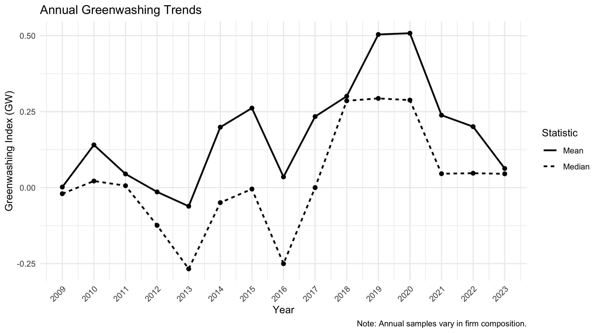
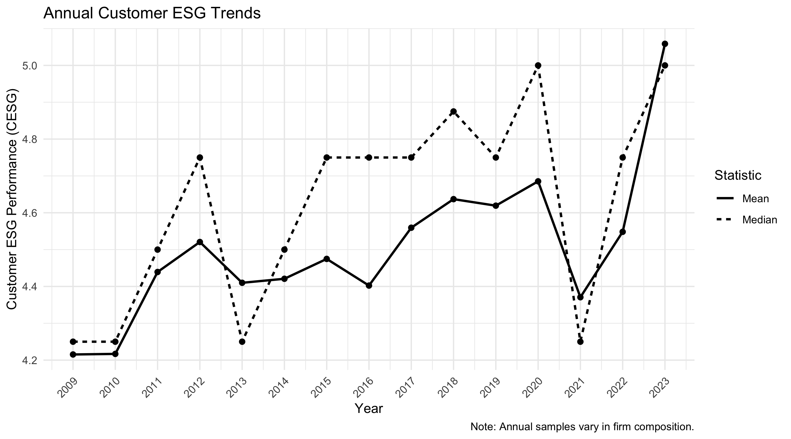
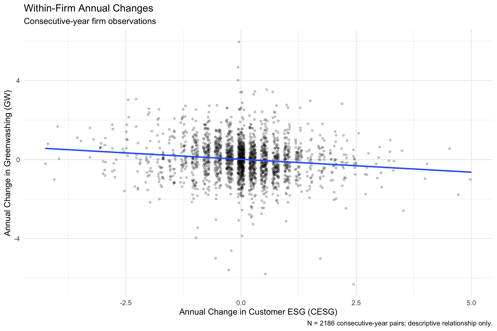
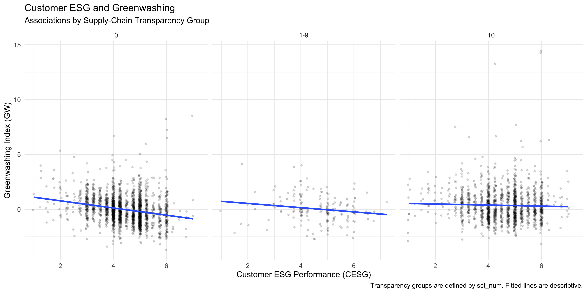

# Greenwashing, Customer ESG, and Supply-Chain Transparency

## Project Overview

This project examines the descriptive relationship between
customer ESG performance and supplier greenwashing among
Chinese listed firms, and whether this relationship differs
across levels of supply-chain transparency.

## Research Aims

1. Describe annual patterns and within-firm changes in
   greenwashing (GW) and customer ESG performance (CESG).
2. Compare the relationship between customer ESG and
   greenwashing across supply-chain transparency groups.


## Results Preview

The following figures were generated directly from the
original data using the reproducible R Markdown pipeline.

### Figure 1. Annual Greenwashing Trends



### Figure 2. Annual Customer ESG Trends



### Figure 3. Within-Firm Annual Changes



### Figure 4. Customer ESG and Greenwashing by Transparency Group



The figures show descriptive associations and should
not be interpreted as evidence of causality.


## Data Source

Chen, H., & Tian, Y. (2025).
*Greenwashing and Customer ESG Performance:
The Moderating Effects of Corporate Transparency.*
Mendeley Data, Version 1.

DOI: https://doi.org/10.17632/vwmj3yrt37.1

The dataset contains 3,709 firm-year observations from
997 Chinese listed firms, covering 2009–2023.

## Repository Structure

- `data/raw/`: Original input data
- `R/`: Data cleaning and analysis scripts
- `results/figures/`: Final figures
- `results/tables/`: Final summary tables
- `docs/`: HTML report for GitHub Pages

## Reproducibility

This repository documents the data source, validation procedures, analytical
decisions, script execution order, and generated outputs.
The complete R Markdown report can be reproduced from a fresh R
session using the original Stata dataset included in the repository.

## Methods

R is used for data validation, panel-structure auditing, descriptive analysis,
correlation analysis, sensitivity checks, and visualization.
The original dataset is preserved without modification.
All analytical results are generated programmatically from the supplied Stata file.

## Data Acquisition and Initial Validation

### Original Data

The original dataset was downloaded from Mendeley Data,
Version 1 (DOI: 10.17632/vwmj3yrt37.1).

The original Stata file is stored at:

`data/raw/data.dta`

The source file is preserved without modification.

### Reproducing the Initial Data Audit

Software: R 4.5.1

Required package: haven

Run the following command from the project root:

```r
source("R/01_import_and_audit.R")
```

The script imports the original Stata file and checks:
- Dataset dimensions
- Number of unique firms
- Year range
- Missing firm-year identifiers
- Duplicate firm-year observations
- Missing values for every variable

### Initial Validation Results

| Metric | Result |
| --- | --- |
| Observations | 3,709 |
| Variables | 34 |
| Unique firms | 997 |
| First year | 2009 |
| Last year | 2023 |
| Missing firm-year identifiers | 0 |
| Duplicate firm-year records | 0 |

All seven key variables (id, year, GW, GWA, CESG,
CESGM, and sct_num) have no missing values.

These findings describe the supplied analysis dataset.
No records were removed or values imputed.

### Generated Outputs

- `results/tables/01_data_summary.csv`
- `results/tables/01_missing_summary.csv`

Both files are generated by the R audit script.

## Panel Structure Validation

### Script
`R/02_panel_structure.R`

Run from the project root:

    source("R/02_panel_structure.R")

### Purpose
The dataset is an unbalanced firm-year panel. We examined
the number of observations per firm, annual coverage,
and gaps between observed years.

To identify valid year-to-year comparisons, observations
were sorted by firm ID and year. A pair was classified as
consecutive only when the difference between the current
and previous observed year was exactly one.

### Results

| Metric | Result |
| --- | ---: |
| Total firm-year observations | 3,709 |
| Unique firms | 997 |
| Firms observed in only one year | 94 |
| Consecutive-year pairs | 2,186 |
| Transitions with a panel gap | 526 |
| Missing years within observed firm spans | 1,337 |

### Interpretation and Limitations

There are 2,186 consecutive-year pairs available for
calculating annual within-firm changes in GW and CESG.

Annual sample coverage is uneven. For example, the number
of observed firms decreases from 480 in 2013 to 161 in
2014, and only 81 firms are observed in 2023.

Therefore, changes in annual sample averages may partly
reflect changes in sample composition rather than changes
within the same firms.

The main within-firm change analysis uses only consecutive-year pairs.
Observations with longer gaps
will not be treated as one-year changes.

No observations were removed during this audit.

### Generated Outputs

- `results/tables/02_panel_summary.csv`
- `results/tables/02_firm_coverage.csv`
- `results/tables/02_annual_coverage.csv`

## Aim 1: Annual Trends and Within-Firm Changes

### Research Questions

1. How do greenwashing (GW) and customer ESG (CESG)
   vary across calendar years?
2. How are within-firm annual changes in CESG
   associated with annual changes in GW?

### Analysis Procedure

The analysis uses the original Stata dataset and
the validated firm-year identifiers.

Script: `R/03_aim1_analysis.R`

The analysis includes:

1. Calculating annual means and medians of GW and CESG.
2. Sorting observations by firm ID and calendar year.
3. Identifying consecutive-year observations.
4. Calculating annual changes in GW and CESG for
   consecutive-year pairs only.
5. Summarizing annual changes across firms and years.
6. Calculating Pearson and Spearman correlations
   between annual changes in CESG and GW.
7. Visualizing annual trends and within-firm changes.

The correlation calculations and visualizations are
included in `Final_Report.Rmd`.

### Main Results

The analysis identifies 2,186 consecutive-year pairs.

| Statistic | Result |
| --- | ---: |
| Mean annual change in GW | 0.0097 |
| Median annual change in GW | 0.0058 |
| Mean annual change in CESG | 0.0321 |
| Median annual change in CESG | 0.0000 |
| Pearson correlation | -0.1291 |
| Spearman correlation | -0.1424 |

The results indicate a weak negative descriptive
association between annual changes in customer ESG
performance and supplier greenwashing.

These correlations do not establish causality.
Repeated firm observations and unobserved characteristics
may influence the observed relationship.

### Output Files

The analysis generates:

- `results/tables/03_annual_trends.csv`
- `results/tables/03_change_summary.csv`
- `results/tables/03_yearly_changes.csv`
- `results/tables/03_correlation_results.csv`

The report presents three figures:

1. Annual Greenwashing Trends
2. Annual Customer ESG Trends
3. Within-Firm Annual Changes

### Reproducing Aim 1

Software used: R 4.5.1

Required R packages:
- haven
- dplyr
- ggplot2
- knitr
- rmarkdown

Install the packages if necessary:

    install.packages(c("haven", "dplyr", "ggplot2",
                       "knitr", "rmarkdown"))

Open the RStudio project and run, in order:

    source("R/01_import_and_audit.R")
    source("R/02_panel_structure.R")
    source("R/03_aim1_analysis.R")

To regenerate the HTML report from a fresh R session,
run from the project root:

    rmarkdown::render("Final_Report.Rmd")

The R Markdown report executes the analysis scripts
and generates the figures, tables, and HTML output.

The original dataset remains unchanged throughout
the pipeline.


## Aim 2: Customer ESG, Greenwashing, and Supply-Chain Transparency

### Research Question

How does the descriptive association between customer ESG
performance and supplier greenwashing differ across levels
of supply-chain transparency?

### Analysis Script

`R/04_aim2_analysis.R`

The analysis uses the original firm-year dataset and
retains all 3,709 observations.

### Transparency Grouping

The supplied transparency variable, `sct_num`, takes
integer values from 0 to 10.

Because observations are heavily concentrated at the
endpoints, the analysis uses three descriptive groups:

| sct_num | Observations | Share |
| --- | ---: | ---: |
| 0 | 2,089 | 56.3% |
| 1–9 | 182 | 4.9% |
| 10 | 1,438 | 38.8% |

This grouping avoids treating the sparsely represented
intermediate values as separate groups.

These are groups of firm-year observations, not necessarily
mutually exclusive sets of firms.

The exact construction and interpretation of the
transparency score are not fully documented in the
supplied replication materials.

### Main Analysis

Within each transparency group, we calculate:

- Number of firm-year observations and distinct firms
- Mean and median greenwashing (GW)
- Mean and median customer ESG performance (CESG)
- Pearson correlation between CESG and GW
- Spearman correlation between CESG and GW
- Descriptive linear association between CESG and GW

The report also presents scatterplots with fitted
linear trend lines for the three groups.

### Main Findings

| Transparency group | Pearson r | Spearman r |
| --- | ---: | ---: |
| 0 | -0.237 | -0.275 |
| 1–9 | -0.171 | -0.210 |
| 10 | -0.034 | -0.049 |

The negative descriptive association is strongest
in the group with sct_num equal to 0 and weakest
in the group with sct_num equal to 10.

These are unadjusted correlations. They do not establish
a statistically significant moderation effect or
a causal relationship.

### Alternative-Measure Analysis

We compare four combinations of the supplied measures:

1. CESG and GW
2. CESGM and GW
3. CESG and GWA
4. CESGM and GWA

Replacing CESG with CESGM produces similar results
when GW is the outcome.

However, replacing GW with GWA substantially changes
the correlations. Therefore, the main descriptive
pattern is not robust to the choice of greenwashing
measure.

The supplied data identify GWA as an alternative
greenwashing measure, but the available documentation
does not establish full directional or measurement
comparability between GW and GWA.

Both variables are retained in their original forms.

### GWA Outlier Sensitivity Analysis

The alternative greenwashing measure GWA contains
extreme negative values.

To examine their influence, we compare the full sample
with a sensitivity sample retaining observations between
the pooled 1st and 99th percentiles of GWA.

The thresholds are:

- 1st percentile: -20.1467
- 99th percentile: 1.3856

The sensitivity sample retains 3,633 observations
and excludes 76 observations from this specific check.

After this exclusion, Pearson correlations change
somewhat but remain close to zero. Spearman correlations
remain relatively stable.

The sensitivity check does not reproduce the negative
CESG-GW association pattern using GWA.

No observations are deleted from the original dataset,
and the full sample remains the primary analysis.

### Aim 2 Generated Outputs

- `results/tables/04_sct_frequency.csv`
- `results/tables/04_sct_group_summary.csv`
- `results/tables/04_sct_association.csv`
- `results/tables/04_alternative_measures.csv`
- `results/tables/04_measure_distribution.csv`
- `results/tables/04_measure_agreement.csv`
- `results/tables/04_GWA_thresholds.csv`
- `results/tables/04_GWA_sensitivity.csv`

The final R Markdown report also includes the
corresponding tables, plots, and interpretations.

## Complete Reproduction Instructions

### Software

The project was developed using R 4.5.1.

The main required packages are:

- haven
- dplyr
- ggplot2
- knitr
- rmarkdown

Install these packages if necessary:

```r
install.packages(
  c("haven", "dplyr", "ggplot2", "knitr", "rmarkdown")
)
```

### Running the Analysis

Clone or download the repository and open its
root directory in RStudio or a Terminal.

The original input file is:

`data/raw/data.dta`

Run the analysis scripts in order:

```r
source("R/01_import_and_audit.R")
source("R/02_panel_structure.R")
source("R/03_aim1_analysis.R")
source("R/04_aim2_analysis.R")
```

Alternatively, generate the complete HTML report
directly from a Terminal in the project root:

```bash
Rscript --vanilla -e 'rmarkdown::render("Final_Report.Rmd", output_format="html_document", quiet=TRUE)'
```

The R Markdown report runs the analysis scripts
and regenerates the tables, figures, and HTML output.

The final report is saved as:

`Final_Report.html`

All CSV outputs are stored in:

`results/tables/`

The complete HTML report was successfully rendered
using a new R process with the `--vanilla` option
on October 19, 2026.

### Reproducibility Scope

The pipeline reproduces the cleaning, validation,
transformation, descriptive statistics, correlations,
sensitivity checks, and report generation starting
from the publicly supplied `data.dta`.

The original researchers also supplied Stata replication
do-files for their published analyses.

However, the available data documentation and do-files
do not provide complete formulas for constructing
all key measures from underlying source records.

Consequently, this project does not claim to reconstruct
the original authors' preprocessed measures from
their underlying financial, ESG, or disclosure sources.

## Overall Limitations

The project has several important limitations.

First, the panel is unbalanced, and firm coverage
varies considerably across years.

Second, the descriptive analyses do not control
for all possible firm-level and year-level factors.

Third, repeated observations from the same firms
mean that simple correlations should not be interpreted
as independent-observation inferential tests.

Fourth, the intermediate transparency group contains
relatively few observations.

Fifth, the original construction formulas for several
key variables are not fully available in the supplied
replication materials.

Finally, the observed CESG-GW relationship is sensitive
to the choice of greenwashing measure.

The results are therefore presented as exploratory
and descriptive rather than causal findings.
